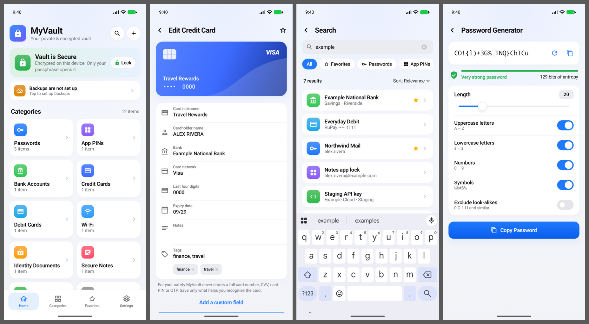
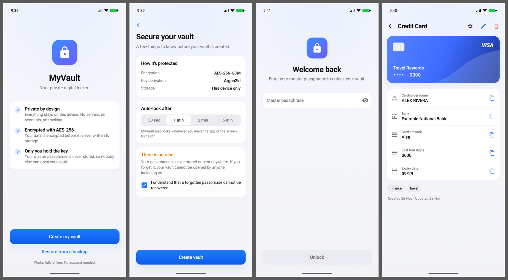
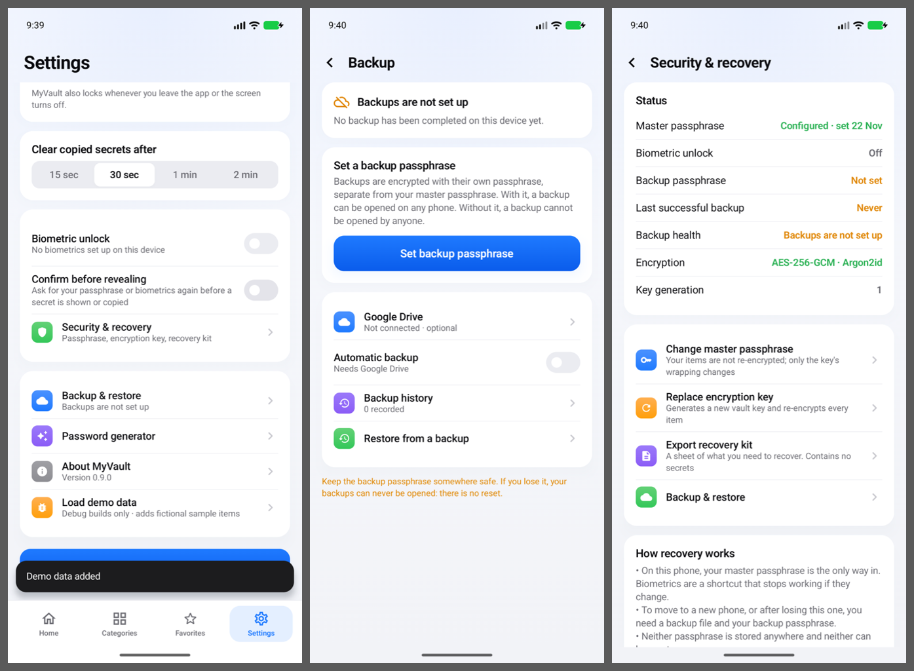
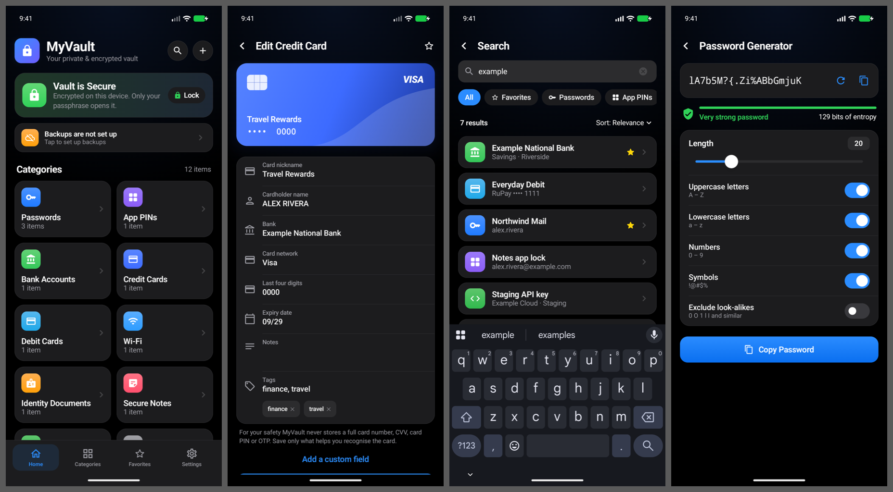

# MyVault

An offline-first Android vault for passwords, PINs, bank details, cards, Wi-Fi, identity
documents, developer secrets and notes. No backend, no account, no analytics. Everything is
encrypted on the device; Google Drive is an optional place to keep encrypted backups.

**Status: all five build phases are implemented.** Read [Security limitations](#security-limitations)
before trusting it with real data: the app has had no independent security review, and two
features have not been exercised end to end (biometric unlock and live Google Drive).






The interface follows iOS conventions on Android: grouped white surfaces on a light grey
background, a single blue accent, solid colour icon tiles, inset list forms, segmented controls
and a matching dark mode. It follows the system light or dark setting.

## What it does

| Area | Details |
|---|---|
| Vault | Master passphrase, optional biometric unlock, auto-lock on leaving the app, screen off or inactivity |
| Records | Ten record types with dedicated forms, custom fields, tags, favorites, encrypted image attachments for identity documents |
| Search | Titles, categories, tags, notes and non-secret fields, entirely in memory. Secret values are never searched |
| Generator | Random passwords from `SecureRandom` with length and character-type options |
| Backup | Encrypted `.vault` files saved anywhere, or uploaded to Google Drive; history, retry, automatic backup |
| Restore | From a file or Google Drive; merge or replace; fully verified before anything changes |
| Recovery | Change master passphrase, replace the vault key, backup passphrase, recovery kit export |

Cards never accept a full card number, CVV, PIN or OTP, and bank accounts refuse transaction
secrets; `ItemValidator` enforces this, not just the form layout.

## Build and run

Requirements: Android Studio (its bundled JDK is enough), Android SDK platform 37 and build-tools,
and an emulator or device on Android 10 (API 29) or later.

```bash
export JAVA_HOME="/Applications/Android Studio.app/Contents/jbr/Contents/Home"
```

```bash
./gradlew :app:installDebug
```

Debug builds add a "Load demo data" row in Settings that inserts fictional records. Screenshots
and screen recording are blocked in every build; to capture screens while developing, opt out
for a debug build (release builds ignore the flag):

```bash
./gradlew :app:installDebug -Pmyvault.allowScreenshots=true
```

### Slim release for a single phone

For a phone on Android 14 or later with a 64-bit ARM processor (such as the Galaxy S24 Ultra),
build a smaller release that leaves out older Android versions, other CPU types and the
libraries' translations:

```bash
./gradlew :app:assembleRelease -Pmyvault.slim=true
```

The APK lands in `app/build/outputs/apk/release/app-release.apk`; it is about 3.8 MB against
4.3 MB for the default release. It will not install on Android 13 or older, or on x86 devices.
The app's own text is English, so nothing visible changes.

### Release signing

Release builds are signed with the key named in a git-ignored `keystore.properties` in the
project root (`storeFile`, `keyAlias`). To create the key on a Mac, run this in the Terminal app
(the hidden password prompt does not work in every embedded terminal):

```bash
./scripts/create-release-key.sh
```

It asks for a password, keeps it only in the macOS login Keychain (item
`myvault-release-keystore`) and writes a 4096-bit RSA key, valid for 30 years, to
`~/Keys/MyVault/myvault-release.jks`. Release builds read the password from Keychain. Elsewhere,
set `MYVAULT_KEYSTORE_PASSWORD` or add `storePassword` to `keystore.properties`.

Without `keystore.properties`, release builds are signed with this machine's debug key. With it,
they never fall back to the debug key: a missing password fails the build instead.

Android only lets an update replace an app signed with the same key. Back up the keystore file
and its password somewhere outside this Mac: losing either means no future update can install
over the existing app, and uninstalling deletes the vault (restore from a backup afterwards).
The Google Drive OAuth client is tied to the signing key's SHA-1, so it must use the release
key's fingerprint.

### Google Drive setup (one time, optional)

Drive backup needs an OAuth client that only you can create, because it is tied to your signing
certificate. Until this is done, "Connect Google Drive" reports that sign-in is not configured.

1. In the [Google Cloud console](https://console.cloud.google.com/), create a project and enable
   the **Google Drive API**.
2. Configure the OAuth consent screen and add the scope `.../auth/drive.file`.
3. Create an **OAuth client ID** of type **Android** with package name `com.myvault.app` and the
   SHA-1 of the certificate that signs your build. For debug builds:

```bash
keytool -list -v -keystore ~/.android/debug.keystore -alias androiddebugkey -storepass android
```

No client ID or secret goes into the app. The device also needs Google Play services and a
signed-in Google account.

Backups go to a `MyVault Backups` folder at the top of My Drive. Let the app create it on the
first backup: with the `drive.file` permission it can see only files and folders created by apps
in its own Google Cloud project, so a hand-made "MyVault Backups" folder is invisible to it and
a second one gets created. Moving the folder elsewhere in My Drive later is fine, including into
a folder of your own; the app still finds it and keeps using it.

## Tests

```bash
./gradlew :crypto:test :app:testDebugUnitTest
```

```bash
./gradlew :app:connectedDebugAndroidTest
```

The first command runs 144 tests on the host JVM. The second runs 25 tests on a connected
emulator or device; with more than one connected, set `ANDROID_SERIAL` to pick one.

| Requirement | Where it is tested |
|---|---|
| Encryption / decryption | `VaultCipherTest`, `SealedStreamTest`, `CryptoOnDeviceTest` (NIST AES-GCM vector, round trips) |
| Wrong passphrase rejection | `PassphraseKeyslotTest`, `VaultManagerTest`, `VaultFlowTest`, `MigrationTest` |
| Tampered ciphertext rejection | `VaultCipherTest` (every bit), `PassphraseKeyslotTest`, `SealedStreamTest`, `VaultRepositoryTest` (moved and modified rows) |
| Nonce uniqueness | `VaultCipherTest`, `CryptoOnDeviceTest` |
| Key derivation | `KeyDerivationTest` (RFC 9106 Argon2id and RFC 5869 HKDF vectors) |
| Biometric unlock | `BiometricSlotTest`, `AppSecurityConfigTest` — **partial, see limitations** |
| Auto-lock | `InactivityTimerTest`, `AutoLockOnDeviceTest`, `ExternalFlowLockTest`, `VaultFlowTest`, `VaultRepositoryTest` (contents dropped synchronously) |
| Database persistence | `VaultPersistenceTest`, `VaultDataOnDeviceTest` (real SQLite, close and reopen) |
| Backup creation / restoration | `BackupManagerTest`, `VaultDataOnDeviceTest` |
| Incorrect backup passphrase | `BackupManagerTest`, `VaultDataOnDeviceTest` |
| Corrupted backup rejection | `BackupManagerTest` (bit flips across the file, truncation, trailing data, spliced bodies), `VaultDataOnDeviceTest` |
| Schema migrations | `MigrationTest` (a version 1 vault still unlocks at version 2) |
| Offline functionality | Every test except `DriveBackupTest` runs with no network; the app has no network code outside `DriveClient` |
| No plaintext secrets in database | `VaultDataOnDeviceTest` (scans the raw database and write-ahead log), `VaultRepositoryTest`, `VaultFlowTest` |
| No sensitive information in logs | `NoLoggingTest` (no logging calls in production code), `VaultFlowTest` (scans logcat) |
| Create, save, export, wipe, restore, verify every record | `BackupManagerTest` (in memory), `VaultDataOnDeviceTest.exportWipeRestoreKeepsEveryRecord` (real database and file) |
| Key rotation | `KeyRotatorTest`, `VaultDataOnDeviceTest` |
| Google Drive client | `DriveBackupTest` against a local stand-in for the Drive v3 API — **not against Google, see limitations** |
| Rules for cards and bank accounts, search | `VaultSearchAndRulesTest` |
| Clipboard clearing | `ClipboardTest` |
| Performance | 2,000 items (JVM) and 1,000 items (device) unlock and search within generous limits |

## Project structure

```
crypto/                 Pure Kotlin/JVM, no Android imports: it cannot log, touch storage or reach
                        a Context.
  SecretBytes           Wipeable key holder with a redacted toString
  AesGcm, VaultCipher   AES-256-GCM and the versioned ciphertext envelope
  SealedStream          Stream of authenticated frames, for backups
  Argon2idKdf, Hkdf     Key derivation (Bouncy Castle)
  PassphraseKeyslot     A key wrapped under a passphrase (vault and backup)
  PasswordGenerator, PassphraseStrength

app/
  security/             VaultSession (in-memory keys), VaultManager, KeyRotator, AutoLockManager,
                        BiometricKeystore, BiometricVault
  vault/                Record model, per-type templates and rules, search, VaultRepository
  backup/               Backup format, BackupKeyManager, BackupManager, DriveClient, DriveUploader,
                        DriveAuthorizer, BackupCoordinator and the upload worker
  data/                 Room database, metadata and record storage, settings
  ui/                   Compose: onboarding, unlock, dashboard, items, generator, backup, settings
  util/                 Secure clipboard, recovery kit, debug demo data
  schemas/              Exported Room schema, one JSON per database version
```

MVVM with repositories: Compose screens observe `StateFlow`s from Hilt view models, which call
the security, vault and backup classes. The root composable switches on one vault state
(`NO_VAULT`, `LOCKED`, `UNLOCKED`), so unlocked screens exist only while the session holds the
keys. View models of the unlocked UI live in a store that is cleared the moment the vault locks.

## Security architecture

### Key hierarchy

```
master passphrase ──Argon2id──▶ KEK ──AES-256-GCM──▶ wrapped VMK   (passphrase slot)
Android Keystore key (biometric-bound) ──AES-256-GCM──▶ wrapped VMK   (biometric slot, optional)

vault master key (VMK, random 256 bits)
   ├─ HKDF "items"            ──▶ encrypts each record
   ├─ HKDF "attachments"      ──▶ encrypts attachment descriptions and chunks
   └─ HKDF "backup-key-wrap"  ──▶ wraps the backup key for use while unlocked

backup passphrase ──Argon2id──▶ KEK ──AES-256-GCM──▶ wrapped backup key   (copied into every backup)
backup key (random 256 bits) ──HKDF(backup id)──▶ encrypts one backup file
```

- Argon2id runs at 64 MiB and 3 passes; the parameters are stored and authenticated with each slot.
- The passphrase is never stored. A wrong passphrase simply fails GCM authentication.
- The biometric slot is a second copy of the VMK under a Keystore key that requires a strong
  biometric for every use and is invalidated when biometrics are enrolled. The passphrase slot
  never depends on the Keystore.
- Before a new vault, a changed passphrase or a rotated key is written, the new slot is reopened
  with the same passphrase. A vault that cannot be unlocked is never persisted.
- **Changing the master passphrase** re-wraps the same VMK. **Replacing the encryption key**
  generates a new VMK, re-encrypts every record and attachment and re-wraps the keys in a single
  database transaction, then drops the biometric slot.

### Records

Each record is one JSON document (type, title, fields, notes, tags, favorite flag, timestamps)
sealed in an envelope whose associated data is the record id. Nothing about a record is stored
in the clear, and a ciphertext moved to another row fails authentication. Attachments are split
into 256 KiB chunks, each bound to its attachment, position and total count.

On unlock every record is decrypted into memory; search runs over that. On lock the session
calls its listeners synchronously, so keys and decrypted contents are dropped in the same call.
A stored record that fails authentication is not shown and is reported on the dashboard.

### Stored formats

All integers are big-endian.

**Envelope** (`VaultCipher`), used for every encryption:

| Offset | Size | Field |
|---|---|---|
| 0 | 1 | Envelope version (1) |
| 1 | 1 | Algorithm (1 = AES-256-GCM, 96-bit nonce, 128-bit tag) |
| 2 | 4 | Key generation |
| 6 | 12 | Nonce, random per encryption |
| 18 | n + 16 | Ciphertext and tag |

Associated data is `header[0..6) || context`.

**Passphrase slot** (`PassphraseKeyslot`):

| Offset | Size | Field |
|---|---|---|
| 0 | 1 | Slot version (1) |
| 1 | 1 | KDF (1 = Argon2id v1.3 over the NFKC-normalized, UTF-8 passphrase) |
| 2 | 4 | Argon2 memory in KiB |
| 6 | 4 | Argon2 iterations |
| 10 | 4 | Argon2 parallelism |
| 14 | 1 | Salt length (32) |
| 15 | 32 | Salt |
| 47 | 66 | Envelope containing the wrapped key |

The envelope context is `label || id || bytes[0..47)`. The label is
`MyVault/keyslot/passphrase/v1` for the vault and `MyVault/keyslot/backup/v1` for backups, so a
slot made for one cannot be opened as the other; the id is the vault id or the backup key id.

**Biometric slot**: `version (1) | IV length | IV | ciphertext and tag`, associated data
`"MyVault/keyslot/biometric/v1" || vaultId || version`.

### Backup format (`.vault`, version 1)

```
8    magic "MYVLTBAK"
1    format version (1)
16   backup key id
16   backup id (random per file)
2    slot length
n    passphrase slot: the backup key wrapped under the backup passphrase
...  sealed stream of records
```

The stream is a sequence of frames, each `final flag (1) | length (4) | envelope`, encrypted
under `HKDF(backup key, "MyVault/backup/stream-key/v1" || backup id)`. Each frame's associated
data is `"MyVault/backup/frame/v1" || backup id || frame index (8) || final flag`, so frames
cannot be reordered, dropped, duplicated or moved between files, and a file that does not end
with its final frame is rejected as truncated.

Each frame's plaintext is one record: a type byte followed by its body.

| Type | Body |
|---|---|
| 1 Manifest | JSON: schema version, creation time, app version, item and attachment counts. Always first |
| 2 Item | The record's JSON |
| 3 Attachment | JSON: id, item id, name, MIME type, size |
| 4 Attachment data | Up to 512 KiB of file bytes |
| 5 Attachment end | Empty |

Backups hold the vault's decrypted contents re-encrypted under the backup key, so they do not
depend on the VMK or the Keystore of the device that made them. Restore decrypts and checks the
whole file once (authentication of every frame, record structure, counts against the manifest)
before writing anything, then imports in one transaction. File names look like
`MyVault_Backup_2026-11-21_1432.vault`.

### What is on disk

One SQLite database (`myvault.db`, schema version 2):

- `vault_metadata`: vault id, format version, key generation, the passphrase and biometric
  slots, the backup key id and its two wrapped copies, timestamps.
- `vault_item`, `encrypted_attachment`, `attachment_chunk`: ciphertext, random ids, chunk counts.
- `backup_metadata`: backup file names, sizes, times, destination and status.
- `security_settings`: timeouts and switches, and when the vault last changed.

Backups waiting for upload sit encrypted in app storage until uploaded. Android backup and
device-to-device transfer are disabled for all app data.

### Locking

The vault locks when the app leaves the foreground, when the screen turns off, after the chosen
period without input (30 seconds to 5 minutes; there is no "never"), or on demand. Timing uses
the monotonic clock. The system file picker and the Google consent screen are announced first,
so returning from them does not find the vault locked; the inactivity and screen-off locks still
apply while they are open.

### Other protections

- `FLAG_SECURE`: no screenshots, screen recording, casting or Recents preview. Verified on a
  release build.
- Passphrases, search text and item drafts are kept out of saved instance state.
- Copied secrets are flagged sensitive and cleared after 15 seconds to 2 minutes.
- Optional re-authentication before a secret is revealed or copied.
- Production code contains no logging calls; a unit test enforces this.
- The only network code is `DriveClient`, HTTPS only, sending only encrypted archives.

## Security limitations

- **Not independently reviewed.** Standard primitives, published test vectors and a broad test
  suite are not a substitute for an audit of the design and code.
- **Biometric unlock has not been exercised end to end.** No test device had an enrolled
  fingerprint, so enrolling, unlocking and re-authenticating through a real `BiometricPrompt`
  were not run. The slot codec is tested, and the Keystore is confirmed to refuse creating the
  key when no biometric is enrolled.
- **Google Drive has not been run against Google.** The client, upload verification, retry and
  pruning logic are tested against a local stand-in built from the Drive v3 documentation. The
  OAuth flow and the real API need the Cloud console setup above and were not run. Treat Drive
  backup as untested until you have made and restored one yourself.
- **The release build was smoke-tested, not fully tested.** An R8-shrunk release APK signed with
  the debug key was installed and used to create a vault, save an item, lock and unlock. The
  automated suites run against the debug build. No release signing is configured.
- **Memory hygiene is best effort.** Text fields, decrypted records and Unicode normalization
  use immutable `String`s that cannot be wiped and live until garbage collected. Keys held by
  the app are zeroed on lock.
- **The keyboard may learn what you type.** Secret fields use password input types, which
  keyboards do not learn from. Titles, usernames, notes and search text use normal input, so a
  keyboard with personalised suggestions may remember them.
- **No protection on a compromised device.** Root, malware with accessibility access or a
  malicious keyboard can observe data while the vault is unlocked.
- **No attempt limiting beyond Argon2id**, and the passphrase slot is deliberately not
  hardware-bound so the passphrase stays a complete recovery path. An attacker who extracts the
  database can guess offline; resistance depends on passphrase strength.
- **Clipboard clearing is blunt.** Android does not let a background app read the clipboard, so
  the timed clear removes whatever is on it, including something copied since.
- **Attachments are images only**, up to 10 MB each, held fully in memory while being encrypted
  or viewed.
- **Notes are plain text.** There is no rich-text formatting.
- **Backup history and the time of the last change are stored unencrypted.** They reveal when
  you used the vault, not what is in it.
- **Argon2id uses 64 MiB of Java heap** and runs single-threaded; very low-memory devices may
  fail to unlock, which the app reports rather than crashing.
- **No recovery.** Forget the master passphrase with no openable backup, and the data is gone.

## Dependency notes

- Gradle 9.9.2, AGP 9.5.2, Kotlin 2.4.21, KSP 2.3.14, Hilt 2.60.1, Room 2.8.5.
- Compose BOM is pinned to 2026.09.00; the newer 2026.11.01 requires SDK platform 37.1.
- `targetSdk` is 36 with `compileSdk` 37. Android 17 behaviour changes have not been reviewed.
- `androidx.biometric` 1.1.0 is the latest stable release.
- `play-services-auth` is used only for Drive authorization; `material-icons-extended` is
  shrunk by R8 in release builds.
