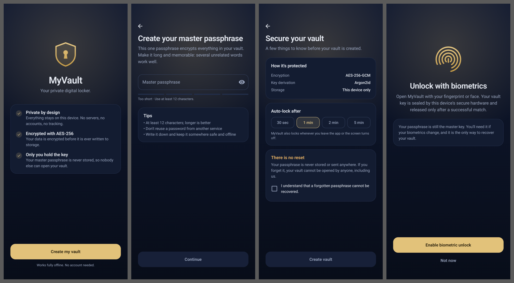
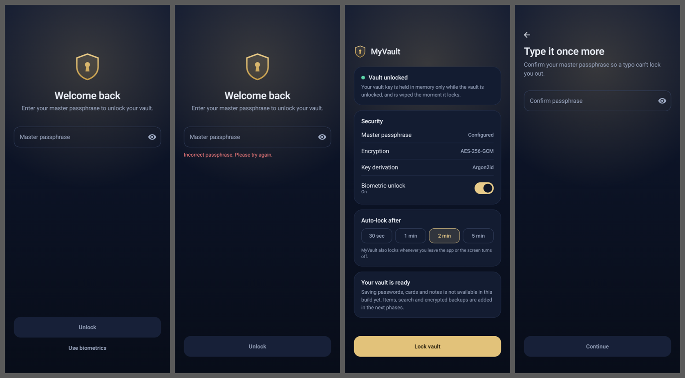

# MyVault

An offline-first Android vault for passwords, PINs, bank details, cards, notes and other private
data. No backend, no account, no analytics, and no network permission.

**Status: Phase 1 of 5 is complete.** The app creates an encrypted vault, unlocks it with the
master passphrase (and optionally biometrics), and locks itself automatically. It does not store
items yet.

| Phase | Scope | State |
|---|---|---|
| 1 | Project setup, encryption, key management, passphrase setup, unlock flow, auto-lock | Done |
| 2 | Encrypted item storage (Room), repository, CRUD, categories, universal search | Not started |
| 3 | Dashboard, item forms, favorites, password generator, bottom navigation | Not started |
| 4 | Encrypted backup format, local export/import, Google Drive, recovery kit, key rotation | Not started |
| 5 | Security review, restore and lifecycle testing, performance | Not started |




## Build and run

Requirements: Android Studio (its bundled JDK is enough), Android SDK platform 37 and build-tools,
and an emulator or device running Android 10 (API 29) or later.

```bash
export JAVA_HOME="/Applications/Android Studio.app/Contents/jbr/Contents/Home"
```

```bash
./gradlew :app:installDebug
```

Screenshots and screen recording are blocked in every build. To capture screens while developing,
install a debug build with the opt-out (release builds ignore it):

```bash
./gradlew :app:installDebug -Pmyvault.allowScreenshots=true
```

## Tests

```bash
./gradlew :crypto:test :app:testDebugUnitTest
```

```bash
./gradlew :app:connectedDebugAndroidTest
```

The first command runs on the host JVM in a few seconds. The second needs a connected emulator or
device; it installs the app, runs the on-device suite, and uninstalls it again.

| Requirement | Where it is tested |
|---|---|
| Encryption / decryption | `VaultCipherTest`, `CryptoOnDeviceTest` (NIST AES-GCM known-answer vector, round trips) |
| Wrong passphrase rejection | `PassphraseKeyslotTest`, `VaultManagerTest`, `VaultPersistenceTest`, `VaultFlowTest` |
| Tampered ciphertext rejection | `VaultCipherTest` (every bit), `PassphraseKeyslotTest` (every byte), `CryptoOnDeviceTest` |
| Nonce uniqueness | `VaultCipherTest`, `CryptoOnDeviceTest` |
| Key derivation | `KeyDerivationTest` (RFC 9106 Argon2id and RFC 5869 HKDF vectors) |
| Auto-lock | `InactivityTimerTest`, `AutoLockOnDeviceTest` (screen off), `VaultFlowTest` (app backgrounded) |
| Database persistence | `VaultPersistenceTest` (real SQLite file, close and reopen) |
| No plaintext secrets in database | `VaultPersistenceTest` (scans the raw database files), `VaultManagerTest` |
| No sensitive information in logs | `NoLoggingTest` (no logging calls in production code), `VaultFlowTest` (scans logcat) |
| Offline | `AppSecurityConfigTest` (no network permission, system backup disabled) |
| Screenshot blocking | `AppSecurityConfigTest` |
| Screens render in both themes | `ScreenRenderingTest` |
| Biometric unlock | `BiometricSlotTest`, `AppSecurityConfigTest` — **partial, see limitations** |
| Backup, restore, schema migrations | Not applicable yet (Phases 2 and 4) |

## Project structure

```
crypto/                 Pure Kotlin/JVM. No Android imports, so it cannot log, touch storage or
                        reach a Context. Everything cryptographic lives here.
  SecretBytes           Wipeable key holder with a redacted toString
  AesGcm, VaultCipher   AES-256-GCM and the versioned ciphertext envelope
  Argon2idKdf, Hkdf     Key derivation (Bouncy Castle)
  PassphraseKeyslot     The master key wrapped under the passphrase
  PassphraseStrength    Strength heuristic for the setup screen

app/
  security/             VaultSession (in-memory key), VaultManager (create, unlock, change
                        passphrase), AutoLockManager, BiometricKeystore, BiometricVault
  data/                 Room database, vault metadata store, security settings
  di/                   Hilt modules
  ui/                   Compose: theme, components, onboarding, unlock, vault status
  schemas/              Exported Room schema, one JSON per database version
```

Architecture is MVVM with repositories: Compose screens observe `StateFlow`s from Hilt view
models, which call `VaultManager`, `BiometricVault` and `SecuritySettingsRepository`.

The root composable switches on a single vault state (`NO_VAULT`, `LOCKED`, `UNLOCKED`). Unlocked
content is only composed while the session holds the key, so no navigation route can reach it
while the vault is locked.

## Security architecture

### Key hierarchy

```
master passphrase ──Argon2id(salt, 64 MiB, 3 passes)──▶ KEK ──AES-256-GCM──▶ wrapped VMK  (passphrase slot)
                                                                                 │
Android Keystore key (biometric-bound, hardware-backed) ──AES-256-GCM──▶ wrapped VMK  (biometric slot, optional)
                                                                                 │
                                                     vault master key (VMK, random 256 bits)
                                                                                 │
                                                    HKDF-SHA256 ──▶ per-purpose keys for records (Phase 2)
```

- The **vault master key** is 256 random bits from `SecureRandom`. It exists in plaintext only in
  memory while the vault is unlocked.
- The **passphrase slot** wraps the master key under a key derived from the passphrase. The
  passphrase is never stored; a wrong passphrase simply fails GCM authentication.
- The **biometric slot** is a second copy of the master key, encrypted by a Keystore key created
  with `setUserAuthenticationRequired(true)`, strong (Class 3) biometrics only, authentication
  required for every use, and invalidation when biometrics are enrolled. The Keystore will not
  perform the decryption until `BiometricPrompt` succeeds, so the UI is not what protects the key.
- The passphrase slot never depends on the Keystore. Losing the Keystore key (biometric change,
  factory reset, new phone) costs only the biometric shortcut.
- Before a new vault or a changed passphrase is written, the new slot is opened again with the
  same passphrase. A vault that cannot be unlocked is never persisted.

### Stored formats

All integers are big-endian.

**Envelope** (`VaultCipher`), used for every encryption:

| Offset | Size | Field |
|---|---|---|
| 0 | 1 | Envelope version (1) |
| 1 | 1 | Algorithm (1 = AES-256-GCM, 96-bit nonce, 128-bit tag) |
| 2 | 4 | Key generation |
| 6 | 12 | Nonce, random per encryption |
| 18 | n + 16 | Ciphertext and tag |

Associated data is `header[0..6) || context`, where the context names the purpose and owner of the
ciphertext. Modifying the header, or moving a ciphertext to another record or role, fails
authentication.

**Passphrase slot** (`PassphraseKeyslot`):

| Offset | Size | Field |
|---|---|---|
| 0 | 1 | Slot version (1) |
| 1 | 1 | KDF (1 = Argon2id v1.3 over the NFKC-normalized, UTF-8 passphrase) |
| 2 | 4 | Argon2 memory in KiB |
| 6 | 4 | Argon2 iterations |
| 10 | 4 | Argon2 parallelism |
| 14 | 1 | Salt length (32) |
| 15 | 32 | Salt |
| 47 | 66 | Envelope containing the master key |

The envelope's context is `"MyVault/keyslot/passphrase/v1" || vaultId || bytes[0..47)`, so the KDF
parameters and salt are authenticated and a slot cannot be transplanted into another vault. Cost
parameters read from storage are bounds-checked before any memory is allocated.

**Biometric slot** (`BiometricSlot`): `version (1) | IV length | IV | ciphertext and tag`, with
associated data `"MyVault/keyslot/biometric/v1" || vaultId || version`.

### What is on disk

One SQLite database (`myvault.db`) with two single-row tables:

- `vault_metadata`: random vault id, format version, key generation, the two slots, timestamps.
- `security_settings`: auto-lock timeout and clipboard-clear duration.

Nothing in it is secret in the clear. Android backup and device-to-device transfer are disabled
for all app data.

### Locking

The vault locks, and the master key is wiped, when:

- the app leaves the foreground,
- the screen turns off,
- there has been no touch or key input for the chosen time (30 seconds to 5 minutes; there is no
  "never"),
- the user taps Lock.

Timing uses the monotonic clock, so changing the device time cannot extend a session.

### Other protections

- `FLAG_SECURE` on the only activity: no screenshots, screen recording, casting or Recents preview.
- Passphrase fields use plain `remember`, never `rememberSaveable`, so a typed passphrase is never
  written to saved instance state.
- Production code contains no logging calls; a unit test enforces this.
- The manifest requests no network permission.

## Backup format

Not designed or implemented yet (Phase 4). Constraints already fixed by this design: backups are
encrypted under a key derived from a separate backup passphrase with its own Argon2id salt, are
independent of the Android Keystore, and reuse the envelope format above.

## Security limitations

Read these before trusting the app with real data.

- **Not independently reviewed.** The cryptography uses standard primitives from the platform
  provider and Bouncy Castle and is tested against published vectors, but the design and code
  have had no third-party audit.
- **Biometric unlock has not been exercised end to end.** The development emulator has no
  enrolled fingerprint, so enrolling, unlocking and invalidation through a real `BiometricPrompt`
  were not run. What is verified: the slot codec, and that the Keystore refuses to create the key
  when no biometric is enrolled. Test on a device with a fingerprint before relying on it.
- **Release build not run.** `assembleRelease` succeeds with R8 shrinking, but only debug builds
  have been installed and tested. No release signing is configured.
- **Memory hygiene is best effort.** Compose text fields hold the passphrase as an immutable
  `String`, Unicode normalization makes one more copy, and JCA key objects keep internal copies.
  These cannot be wiped and live until garbage collected. Keys held by the app itself are zeroed
  on lock.
- **No protection on a compromised device.** Root, malware with accessibility access, or a
  malicious keyboard can observe the passphrase as it is typed.
- **No attempt limiting beyond Argon2id.** Each guess costs about 0.4 seconds on the
  development emulator, and there is no lockout or wipe after repeated failures. Resistance to offline
  guessing of a copied database depends on passphrase strength and the Argon2id cost.
- **The passphrase slot is not hardware-bound.** This is deliberate: it keeps the passphrase a
  complete recovery path. It means an attacker who extracts the database can guess offline.
- **Argon2id runs single-threaded on the Java heap** (Bouncy Castle), using 64 MiB. Very
  low-memory devices may fail to unlock; the app reports this rather than crashing.
- **Strength meter is a heuristic**, not a guarantee.
- **Typing does not reset the inactivity timer** when input goes through the on-screen keyboard.
  Irrelevant today (no text entry while unlocked), but must be handled when item forms arrive.
- **No recovery.** A forgotten passphrase means the vault cannot be opened. Until Phase 4 there is
  no backup either, so uninstalling the app destroys the vault.

## Dependency notes

- Compose BOM is pinned to 2026.09.00. The newer 2026.11.01 requires compiling against SDK
  platform 37.1; move up once that platform is installed.
- `targetSdk` is 36 while `compileSdk` is 37. Android 17 behaviour changes have not been reviewed.
- `androidx.biometric` 1.1.0 is the latest stable release; 1.4.0 is still a release candidate.
